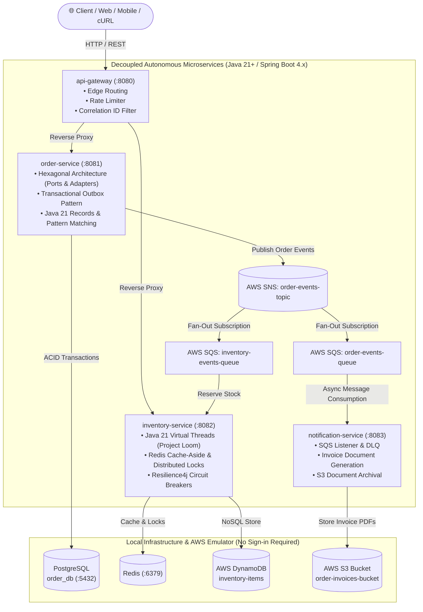

# AWS Demo: Cloud-Native Decoupled Java Microservices

A production-grade, enterprise-scale demo platform showcasing **advanced Java 21+ engineering**, **Hexagonal Architecture**, **Event-Driven Architecture (EDA)**, **Docker**, **Kubernetes**, and **100% Local AWS Cloud Emulation (Zero Sign-in required)**.

Every microservice in this repository is designed as an **autonomous, decoupled entity** with its own folder, standalone Git history, independent Maven wrapper, and self-contained build/runtime lifecycle. You can clone and run any service by itself, or run the entire ecosystem as a cohesive distributed platform.

---

## 🏛️ System Architecture



---

## 🚀 Key Architectural Highlights

1. **Truly Decoupled Microservice Entities**:
   - **Database-per-Service**: Each service owns its dedicated data store (`order_db`, Redis cache, DynamoDB table, S3 bucket). Zero shared tables.
   - **Independent Git Histories**: Every service has its own initialized Git repository and commit history.
   - **Clone & Run Anywhere**: Each service contains its own Maven wrapper (`./mvnw`), standalone `pom.xml`, and `Dockerfile`. It requires zero parent files to build and run.
2. **Modern Java 21+ Capabilities**:
   - **Virtual Threads (Project Loom)**: Non-blocking high concurrency in `inventory-service` without reactive callback complexity.
   - **Records as Immutable DTOs**: Zero boilerplate, compiler-enforced data carriers.
   - **Sealed Interfaces & Pattern Matching**: Strict algebraic domain event hierarchies with exhaustive `switch` dispatching.
   - **Defensive Immutability**: Functional `Result<T, E>` monads eliminating null checks and unexpected runtime exceptions.
3. **Local AWS Cloud Emulation**:
   - Zero AWS account, zero credit card, and zero cloud sign-in required.
   - Emulates **AWS SQS, SNS, S3, and DynamoDB** on `http://localhost:4566`.
   - Pre-configured AWS SDK v2 client beans with auto-wired local endpoint overrides.
4. **Cloud-Native Deployment**:
   - Docker Compose orchestrator for instant local stack bootstrapping.
   - Kubernetes manifests (`k8s/`) ready for Kustomize / Minikube / Docker Desktop K8s.

---

## 📂 Repository Directory Structure

```text
aws-demo/
├── .mvn/                                # System orchestrator Maven wrapper
├── mvnw / mvnw.cmd                     # System build scripts
├── pom.xml                             # System aggregator POM
├── docker/                             # Local infrastructure & Orchestration
│   ├── docker-compose.yml              # LocalStack (AWS emulator), Postgres, Redis, Services
│   ├── Dockerfile                      # Unified container build recipe
│   └── aws-init/                       # Automatic cloud resource provisioning
│       ├── 01-init-aws.sh              # S3 buckets, SQS queues, SNS topics, DynamoDB tables
│       └── 01-init-aws.bat             # Windows batch equivalent
├── k8s/                                # Kubernetes manifests (Kustomize ready)
│   ├── kustomization.yaml              # One-command cluster deployment
│   ├── base/                           # Namespaces, ConfigMaps, Secrets
│   ├── infra/                          # Local AWS Emulator, PostgreSQL, Redis manifests
│   └── services/                       # Microservice Deployments & Services
├── services/                           # Autonomous Microservices (Each has its own Git history)
│   ├── order-service/                  # Hexagonal Architecture + Outbox + SQS (Port: 8081)
│   ├── inventory-service/              # Virtual Threads + Redis Cache + DynamoDB (Port: 8082)
│   ├── notification-service/           # Async SQS Consumer + DLQ + S3 Invoices (Port: 8083)
│   └── api-gateway/                    # Edge Routing + Rate Limiting + Correlation ID (Port: 8080)
├── common/                             # Shared foundation libraries
│   ├── common-domain/                  # Result monad, sealed events, immutable records
│   └── common-aws/                     # AWS SDK v2 auto-configuration for local emulator
└── docs/                               # Detailed technical documentation
    ├── ARCHITECTURE.md                 # System diagrams, Hexagonal deep dive, EDA
    ├── JAVA_SKILLS_CATALOG.md          # Complete catalog of Java skills & design patterns
    ├── LOCAL_AWS_EMULATOR_GUIDE.md     # Guide to local AWS emulation & CLI commands
    └── ROADMAP.md                      # Phase-by-phase implementation roadmap
```

---

## ⚡ Quickstart: Launch Everything & Open Dashboard

To start the entire microservices platform, spin up all infrastructure (Kafka, PostgreSQL databases, Redis, Keycloak, LocalStack AWS Emulator), wait for health checks, and **automatically open the Control Center Dashboard** at `http://localhost:8090`:

### Via Docker Compose (Recommended for local dev)
```powershell
# On Windows (PowerShell)
.\start.ps1

# On Linux / macOS / Git Bash
./scripts/start-local.sh
```

### Via Kubernetes (Minikube / Docker Desktop K8s)
```powershell
# On Windows (PowerShell)
.\start.ps1 -Mode k8s

# On Linux / macOS / Git Bash
./scripts/start-local.sh k8s
```

### To Stop Everything
```powershell
# On Windows (PowerShell)
.\stop.ps1

# On Linux / macOS / Git Bash
./scripts/stop-local.sh
```

---

## ⚡ Additional Options

### Option A: Clone & Run a Single Microservice Standalone
Because every service is an independent entity with its own Git repo, you can cd into any service and run it in isolation:

```bash
# Navigate to order-service
cd services/order-service

# Build and run standalone (uses embedded H2 and local AWS emulator)
./mvnw clean test
./mvnw spring-boot:run
```

Or run standalone in Docker:
```bash
docker build -t order-service:latest .
docker run -p 8081:8081 order-service:latest
```

---

### Option B: Run the Entire System with Docker Compose
Start the Local AWS Emulator, PostgreSQL, Redis, and all microservices in one command:

```bash
cd docker
docker compose up -d
```

Verify services:
- **API Gateway**: `http://localhost:8080/actuator/health`
- **Order Service**: `http://localhost:8081/actuator/health`
- **Inventory Service**: `http://localhost:8082/actuator/health`
- **Notification Service**: `http://localhost:8083/actuator/health`
- **AWS Emulator Health**: `http://localhost:4566/_localstack/health`

---

### Option C: Deploy to Local Kubernetes
Deploy the entire microservice ecosystem and infrastructure to Minikube or Docker Desktop Kubernetes:

```bash
kubectl apply -k k8s/
```

Check rollout status:
```bash
kubectl get pods -n microservices-demo
```

---

### Option D: Build All Services from Root (Reactor)
Run tests and package all services from the root aggregator:

```bash
# On Linux / macOS
./mvnw clean test

# On Windows
.\mvnw.cmd test
```

---

## 📚 Technical Documentation

- 📖 [Architecture Deep Dive](docs/ARCHITECTURE.md): Hexagonal architecture, Outbox pattern, and Event-Driven choreography.
- ☕ [Java Skills Catalog](docs/JAVA_SKILLS_CATALOG.md): Exhaustive guide to modern Java 21+ features, Virtual Threads, and design patterns.
- ☁️ [Local AWS Emulator Guide](docs/LOCAL_AWS_EMULATOR_GUIDE.md): Local AWS emulation instructions, SQS/SNS/S3/DynamoDB CLI commands with no sign-in.
- 🗺️ [Implementation Roadmap](docs/ROADMAP.md): Evolutionary milestones from skeleton to production.
