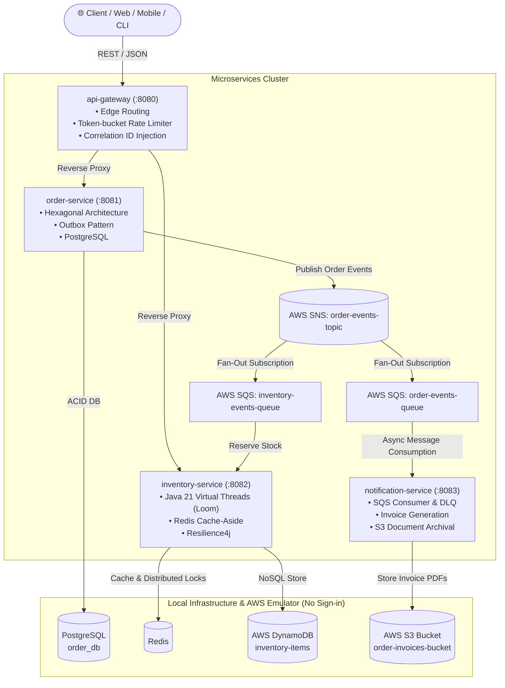

# System Architecture & Microservice Design

This document describes the architectural principles, component interactions, and decoupling patterns implemented across the **AWS Demo** microservices platform.

---

## 1. Architectural Philosophy: Decoupled Autonomous Microservices

The system is organized around **high cohesion and loose coupling**. Every microservice is a standalone bounded context and independent entity:

1. **Database-Per-Service Pattern**: No microservice directly queries or touches another service's database. Data encapsulation is absolute:
   - `order-service` exclusively owns `order_db` (PostgreSQL).
   - `inventory-service` exclusively owns its inventory store and Redis cache.
   - `notification-service` is an asynchronous worker writing generated invoices directly to AWS S3.
2. **Asynchronous Event-Driven Decoupling**:
   - Synchronous HTTP/REST is strictly reserved for client-facing edge queries and commands via `api-gateway`.
   - Inter-service coordination (e.g. order placement triggering inventory deduction and customer email notifications) occurs via **AWS SNS & SQS pub/sub event fan-out**.
   - If `notification-service` or `inventory-service` experiences downtime or high load, `order-service` is completely unaffected; messages buffer safely in durable SQS queues.
3. **Autonomous Lifecycle**:
   - Each service has its own build descriptor, container packaging (`Dockerfile`), health probes, and Kubernetes deployment configuration.

---

## 2. High-Level Architecture Diagram



---

## 3. Microservice Deep Dives

### A. `order-service` (Hexagonal Architecture / Ports & Adapters)
`order-service` demonstrates Domain-Driven Design (DDD) with clean separation of domain logic from external frameworks:

```text
order-service/
├── domain/                    <-- Pure Java domain models, business invariants (Zero Spring imports)
│   ├── model/ (Order, OrderItem, OrderStatus)
│   └── event/ (OrderEvents)
├── port/                      <-- Contracts defining system boundaries
│   ├── in/ (PlaceOrderUseCase, CancelOrderUseCase)
│   └── out/ (OrderRepositoryPort, OrderEventPublisherPort)
├── adapter/                   <-- Framework & infrastructure specific implementations
│   ├── in/web/ (OrderRestController)
│   ├── out/persistence/ (JpaOrderRepositoryAdapter, Postgres Entities)
│   └── out/messaging/ (AwsSqsOrderEventPublisherAdapter)
└── application/               <-- Use case orchestrators (Transactional boundary)
```

#### The Transactional Outbox Pattern
To prevent dual-write vulnerabilities (writing to DB and publishing to SQS within the same request), `order-service` implements the **Transactional Outbox Pattern**:
1. When an order is placed, both the `Order` entity and an `OutboxEvent` record are persisted inside a single local ACID database transaction.
2. A lightweight background poller (leveraging Java 21 Virtual Threads) reads unpublished outbox rows and sends them to AWS SNS/SQS.
3. Upon acknowledgement from SQS, the outbox record is marked as `SENT`.

---

### B. `inventory-service` (High-Throughput Concurrency & Project Loom)
`inventory-service` handles high-frequency stock queries and reservations:
- **Java 21 Virtual Threads**: Handles thousands of concurrent HTTP requests without thread-pool starvation (`spring.threads.virtual.enabled: true`).
- **Redis Cache-Aside**: Stock levels are cached in Redis with distributed locking to prevent race conditions during flash sales.
- **Resilience4j Integration**:
  - *CircuitBreaker*: Protects downstream data sources when latency spikes.
  - *RateLimiter*: Enforces client quotas.
  - *Retry with Exponential Backoff*: Automatically handles transient network hiccups when contacting AWS emulator or Redis.

---

### C. `notification-service` (Event-Driven Asynchronous Consumer)
`notification-service` is an asynchronous worker service:
- **SQS Consumer**: Continuously processes messages from `order-events-queue`.
- **Idempotent Message Processing**: Deduplicates incoming events using message GUIDs to guard against SQS at-least-once delivery guarantees.
- **Dead Letter Queue (DLQ)**: Poison pills or failed message payloads are routed to `order-events-dlq` after 3 retry attempts for analysis.
- **AWS S3 Document Archival**: Formats order confirmation invoices and archives them directly into `s3://order-invoices-bucket`.

---

### D. `api-gateway` (Edge Routing & Cross-Cutting Concerns)
- **Unified Entry Point**: Exposes a single public port (`8080`), abstracting internal service locations.
- **Correlation ID Tracking**: Generates and propagates `X-Correlation-ID` HTTP headers across all downstream service calls and SQS message attributes.
- **Rate Limiting**: Protects backend services against denial-of-service traffic.
