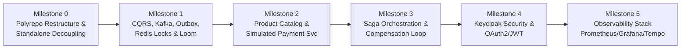

# Implementation Roadmap & Engineering Milestones

This document tracks the phased milestones for the **E-Commerce Order Management and Fulfilment Platform**, advancing from repository restructuring to production-grade distributed resilience.

---

## 🎯 Phase Overview

---

## Milestone 0: Decoupled Multi-Service Skeleton & Polyrepo Infrastructure (Completed ✅)
- [x] Transformed repository into decoupled autonomous microservices inside an umbrella orchestrator.
- [x] Initialized standalone Git repositories and independent commit histories for each service (`services/*`).
- [x] Provisioned standalone Maven wrappers (`mvnw`, `mvnw.cmd`, `.mvn/`) and `Dockerfile` inside every service so each can be cloned and built in total isolation.
- [x] Wrote Docker Compose stack with **Local AWS Emulator** (LocalStack for SQS, SNS, S3, DynamoDB with zero sign-in), PostgreSQL, and Redis.
- [x] Authored architecture documentation, Java skills catalog, and emulator guide.

---

## Milestone 1: CQRS, Event-Driven Backbone & Concurrency (Completed ✅)
- [x] **`order-service`**: Implemented CQRS write command handler (`CreateOrderCommand`, `CancelOrderCommand`) and read query handler (`GetOrderByIdQuery`, `OrderView`) with Redis Cache-Aside.
- [x] **Transactional Outbox Pattern**: Implemented atomic outbox table insertion and event publisher broadcasting to Kafka topic `order-events` and AWS SQS queue `order-events-queue`.
- [x] **`inventory-service`**: Implemented Redis distributed concurrency locking (`RedisDistributedLock` with `SET NX PX`) and Java 21 Virtual Threads (Project Loom) stock audit.
- [x] **`notification-service`**: Implemented Idempotent Consumer filter (`IdempotentMessageStore`), Kafka listener, and AWS S3 document archival adapter.
- [x] **`api-gateway`**: Implemented token-bucket rate limiter (`RateLimiterService`) and correlation ID tracing filter (`CorrelationIdFilter` injecting `X-Correlation-ID`).

---

## Milestone 2: Catalog & Payment Simulation Services (Completed ✅)
- [x] **`services/product-service`**:
  - Standalone Git repository (`93b2ece`), dedicated Maven wrapper, Dockerfile, and README.
  - Domain aggregate `Product`, value object `Category`, immutable Java 21 Records (`ProductDto`, `CreateProductRequest`).
  - Spring Data JPA repository and service with category and name search.
  - REST endpoints: `GET /api/products`, `GET /api/products/{id}`, `GET /api/products/sku/{sku}`, `POST /api/products`, `DELETE /api/products/{id}`.
  - Standalone unit & integration tests passing 5/5.
- [x] **`services/payment-service`**:
  - Standalone Git repository (`374dd0e`), dedicated Maven wrapper, Dockerfile, and README.
  - Domain aggregate `Payment`, enum `PaymentStatus`, immutable Java 21 Records (`ProcessPaymentCommand`, `PaymentResult`, `PaymentResponseDto`).
  - Deterministic simulated payment adapter (`SimulatedPaymentProviderAdapter`):
    - Standard amounts: `CAPTURED` with transaction reference.
    - Amounts ending in `.99` (e.g. `$19.99`): `DECLINED` (Insufficient funds trigger for Saga compensation).
    - Amounts ending in `.50` (e.g. `$49.50`): `FAILED` (Gateway timeout trigger for resilience testing).
  - Idempotency guarantee preventing duplicate charges on identical `idempotency_key`.
  - Event publishing to Kafka topic `payment-events` (`PaymentCapturedEvent`, `PaymentFailedEvent`).
  - Standalone unit & integration tests passing 5/5.

---

## Milestone 3: End-to-End Saga Orchestration & Compensation (Completed ✅)
- [x] **Saga Orchestrator in `order-service`**:
  - Implemented `OrderSagaOrchestrator` listening to Kafka topic `payment-events`.
  - Confirms order upon receiving `PaymentCapturedEvent`.
  - Executes compensating transaction upon receiving `PaymentFailedEvent`, moving order to `CANCELLED` and publishing `OrderCancelledEvent` with affected items payload.
- [x] **Compensating Stock Release in `inventory-service`**:
  - Added `releaseStock(productId, quantity)` using atomic Redis distributed locks.
  - Added REST endpoint `POST /api/inventory/release`.
  - Enhanced `OrderEventListener` to trigger automated stock release when receiving cancellation events.
- [x] **Gateway Routing**:
  - Updated `api-gateway` with routes to `product-service` (:8085) and `payment-service` (:8084).
- [x] **System-Wide Verification**:
  - All 11 modules in the Maven aggregator reactor build cleanly and pass all 31 unit & integration tests.

---

## Milestone 4: Database Hardening & Flyway Schema Migrations (Completed ✅)
- [x] Standardized version-controlled schema migrations with **Flyway 12.4.0** across all relational database microservices.
- [x] **`services/order-service`**:
  - Authored `V1__init_order_schema.sql` defining `orders`, `order_items`, and `outbox_events` tables with foreign key cascades and composite indexes.
  - Configured PostgreSQL DDL validation (`ddl-auto: validate`) and automatic Flyway baseline-on-migrate.
- [x] **`services/product-service`**:
  - Authored `V1__init_product_schema.sql` defining `products` table and performance indexes on `sku` and `category`.
  - Authored `V2__seed_products.sql` seeding initial electronic, accessory, and home catalog items.
- [x] **`services/payment-service`**:
  - Authored `V1__init_payment_schema.sql` defining `payments` table with unique constraint on `idempotency_key` and index on `order_id`.
- [x] Maintained test profile isolation with in-memory H2 database fallback for ultra-fast unit testing.

---

## Milestone 5: Centralized Security with Keycloak (Upcoming ⏳)
- [ ] Add Keycloak 25 service in `docker-compose.yml` with pre-seeded `ecommerce` realm.
- [ ] Configure Spring Security OAuth2 Resource Server with JWT token verification on API Gateway and downstream services.

---

## Milestone 6: Distributed Observability & Golden Signals (Upcoming ⏳)
- [ ] Integrate Prometheus metrics and Grafana dashboards for latency, traffic, errors, and saturation.
- [ ] Add OpenTelemetry distributed tracing with Jaeger / Grafana Tempo.
