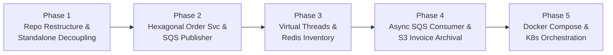

# Implementation Roadmap & Engineering Milestones

This document outlines the evolutionary roadmap for the **AWS Demo** cloud-native platform, detailing the progression from repository restructuring to production-grade distributed resilience.

---

## 🎯 Phase Overview

---

## Milestone 1: Decoupled Multi-Service Skeleton & Infrastructure (Completed ✅)
- [x] Restructured repository from monolithic flat starter into decoupled autonomous microservices.
- [x] Created individual Git histories for each service (`services/order-service`, `services/inventory-service`, `services/notification-service`, `services/api-gateway`).
- [x] Provisioned standalone Maven wrappers and Dockerfiles inside each service so any service can be cloned and run in isolation.
- [x] Wrote Docker Compose stack integrating **Local AWS Emulator** (LocalStack for SQS, SNS, S3, DynamoDB with zero sign-in), PostgreSQL, and Redis.
- [x] Wrote and verified Kubernetes manifests (`k8s/`) with Kustomize overlay.
- [x] Authored comprehensive documentation (`ARCHITECTURE.md`, `JAVA_SKILLS_CATALOG.md`, `LOCAL_AWS_EMULATOR_GUIDE.md`).

---

## Milestone 2: Order Service Business Logic & Hexagonal Outbox
- [ ] Implement Hexagonal Ports and Adapters for `order-service`:
  - `PlaceOrderUseCase` interface and validation rules.
  - `OrderRepositoryPort` with PostgreSQL JPA adapter.
  - `OrderEventPublisherPort` with Transactional Outbox table and SQS publisher.
- [ ] Unit & slice tests with Mockito and AssertJ.
- [ ] Integration test using Testcontainers for PostgreSQL and SQS.

---

## Milestone 3: Inventory Service Concurrency & Virtual Threads
- [ ] Configure Java 21 Project Loom virtual thread executor for high-concurrency reservation endpoints.
- [ ] Implement Redis distributed locks (`SETNX` / Redisson) to prevent overselling.
- [ ] Integrate Resilience4j:
  - Circuit Breaker for Redis read failures.
  - Rate Limiter for inventory probe endpoints.
- [ ] Implement AWS DynamoDB repository adapter for item catalog storage.

---

## Milestone 4: Notification Service & S3 Archival
- [ ] Implement `@SqsListener` for `order-events-queue`.
- [ ] Implement Idempotent Consumer filter using message GUIDs.
- [ ] Render HTML/PDF invoice summaries upon receiving `OrderCreatedEvent`.
- [ ] Upload generated invoices to `s3://order-invoices-bucket` via AWS SDK v2 `S3Client`.
- [ ] Dead-Letter Queue (DLQ) poison pill retry and alerting.

---

## Milestone 5: API Gateway & Production Packaging
- [ ] Configure edge routing to downstream services.
- [ ] Implement correlation ID (`X-Correlation-ID`) generation and logging filter.
- [ ] Build multi-arch container images using Docker buildx.
- [ ] Deploy and verify full stack on local Kubernetes (Minikube / Docker Desktop K8s).
